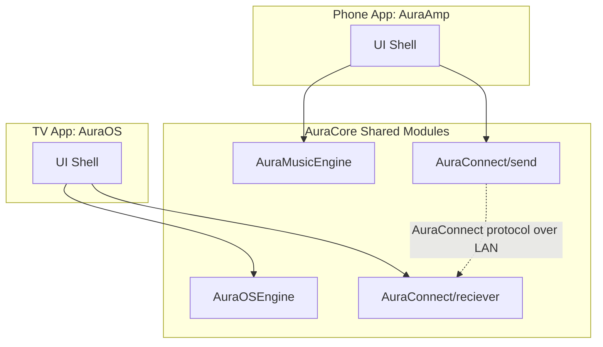

# AuraSystem Architecture Specification

AuraSystem is a modular multi-platform ecosystem separating core engine logic, communication protocols, and cross-device synchronization into **`AuraCore`**, while client applications (`AuraAmp` for mobile/audio, `AuraOS` for TV/receiver) act as clean, lightweight UI and design shells.

---

## Core Philosophy

1. **Write Once, Import Everywhere**: All functional code, streaming engines, credential vaults, local sync mechanisms, and AuraConnect protocols reside exclusively in `AuraCore` modules.
2. **App Shell Pattern**: Client apps manage only UI layouts, themes, JavaScript/WebView hosts, and design assets. They import shared modules as Gradle dependencies.
3. **Cross-System Sync & Protocols (AuraConnect)**:
   - **`AuraCore/AuraConnect/send`**: Sender module (mobile/tablet) for QR/code pairing, ARL sync, remote control, and playlist/media pushing.
   - **`AuraCore/AuraConnect/reciever`**: Receiver module (TV/display) providing system-wide 6-digit persistent pairing code generation and direct media streaming/casting into the OS.

---

## Ecosystem Directory Structure

```text
AuraSystem/
├── AuraCore/
│   ├── AuraMusicEngine/       # Shared audio playback, ExoPlayer, local sync v2, Spotify import, widget
│   ├── AuraOSEngine/          # TV OS UI components, catalog management, media server clients (Plex/Jellyfin)
│   └── AuraConnect/
│       ├── send/              # AuraConnect sender client (mobile integration)
│       └── reciever/          # AuraConnect receiver server & system-wide pairing manager
├── Phone/
│   └── AuraAmp/               # Mobile app shell (imports AuraMusicEngine & AuraConnect/send)
├── TV/
│   └── AuraOS/                # TV app shell (imports AuraOSEngine & AuraConnect/reciever)
└── Desktop/                   # Desktop app shells
```

---

## Architectural Workflow



---

## Benefits

- **Zero Code Duplication**: Features are maintained once in `AuraCore`.
- **Independent Builds**: Modules compile as independent Android library modules, ensuring fast compilation and clean dependency graphs.
- **System-Wide Integration**: Services like AuraConnect operate system-wide across devices without requiring redundant application code.
