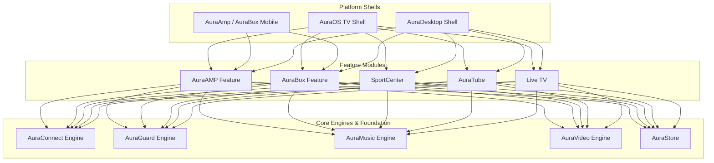

# AuraOS V2 Modular Architecture

This document defines the unified cross-platform architecture of the Aura Ecosystem (AuraOS, Mobile, and Desktop).

## Architectural Layers

### 1. Platform Shells (`:apps:...`)
- **AuraOS (Google TV / Android TV)**: Thin shell combining AuraAMP, AuraBox, SportCenter, AuraTube, and LiveTV with 10-foot D-pad navigation and AuraConnect/AuraGuard integration.
- **Mobile (Android / iOS)**: AuraAmp and AuraBox apps acting as lightweight, responsive mobile shells.
- **Desktop (macOS / Windows / Linux)**: AuraDesktop shell integrating all engines and media features with native player bindings.

### 2. Feature Modules (`:features:...`)
- Shared domain logic and Compose UI components for `AuraAMP`, `AuraBox`, `SportCenter`, `AuraTube`, and `Live TV`.

### 3. Core Engines & Foundation (`:core:...`)
- **AuraCore**: Foundational services, base persistence, future `AuraStore`.
- **Engines**: `AuraConnect`, `AuraGuard`, `AuraMusic Engine`, `AuraVideo Engine`, `LiveTV Engine`, `SportsEngine`, `TubeEngine`.
